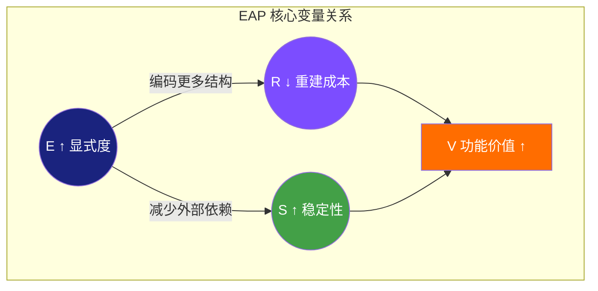
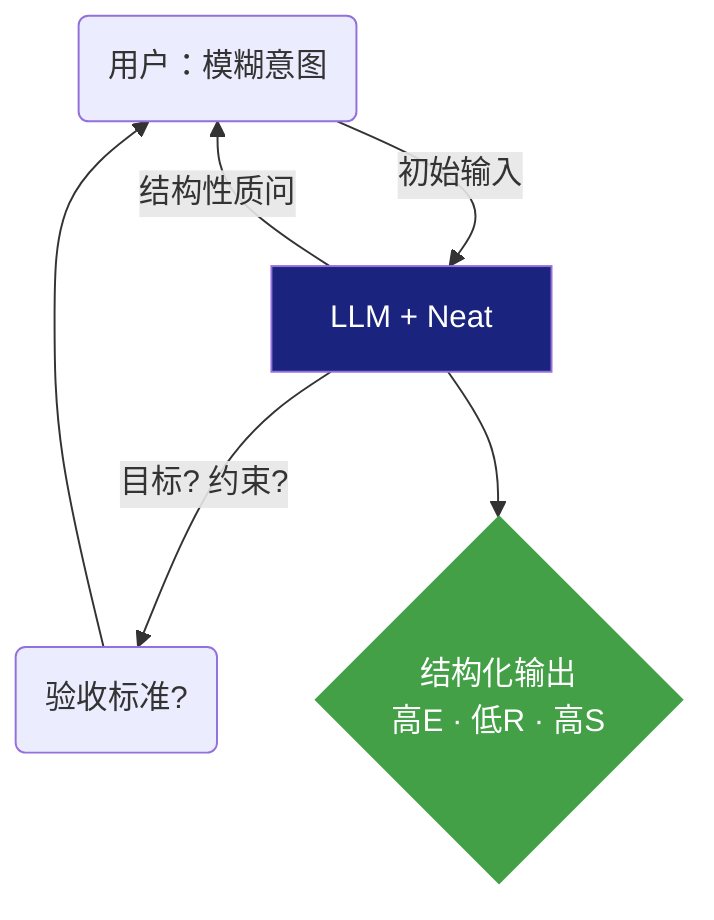
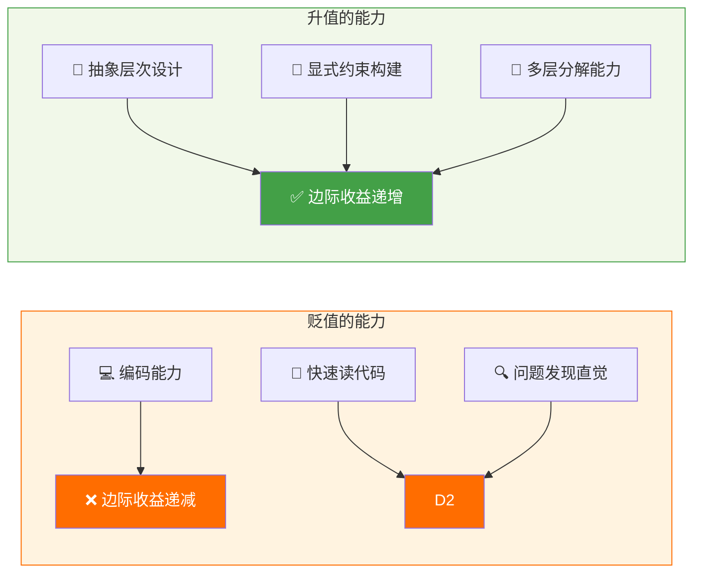

# Explicit Abstraction Principle (EAP)
## On the Externalizability of Thought in the Age of LLMs

> Author: [tellmewhattodo](https://github.com/tellmewhattodo)

> **摘要：** 我们提出一个"大语言模型时代显式抽象"的理论框架，认为人类思维的功能价值日益取决于其能否被外部化为结构化的、机器可解析的表达。核心命题是：思维的功能价值与其外部可重建性成正比。我们区分显式抽象与隐式抽象两种模式，定义三个核心变量——显式度(E)、重建成本(R)、稳定性(S)，并提出EAP原则：在LLM主导的认知环境中，E↑、R↓、S↑时，思维的功能价值趋于最大化。语言不是决定因素，而是调制默认外部化策略的接口。

---

## 1. 引言：前置抽象的无穷性

> 在传统的软件开发中，程序员的核心工作是编码——将需求转化为可执行的指令。然而在大语言模型（LLM）时代，这一优先级正在发生根本性的逆转：我们不再需要过多关注编码本身，而需要更多关注编码的前置抽象——从接口定义，到技术方案设计，再到需求本身的合理性与实体关系范围。LLM能够替代你完成实现细节，前提是你清晰地表达出更高层级的抽象。
>
> 然而更深远的变化在于：前置抽象的层级是无穷的。接口定义之下有编码，技术方案之下有接口，需求之下有方案设计，而需求本身又可以向上追问其合理性、追问其背后的存在论与认识论前提。这种无穷性不是负担，而是解放——你不需要通晓所有细节，你只需要将你所关注的那一个层级的抽象做到足够完善，其下的所有层级都可以委托给LLM去完成。这就是LLM时代智力活动的结构性迁移：价值不在实现，而在抽象。
>
> **本文对"抽象"一词的使用，需要特别说明。** 在中文语境中，"抽象"一词已过于宽泛，可指称哲学思辨、模糊想象、感性直觉，或任何缺乏具体内容的表达。本文不在此意义上使用该词。本文所称"抽象"，是指一个通用信息处理过程中，少量约束驱动LLM进行大量工作的那个环节——作为动词，指构建这些少量约束的行为；作为名词，指这一构建的结果。换言之，抽象是你需要做的事情，LLM替你做的不是抽象。你定义一个接口的签名、描述一个业务的实体关系、划定一个需求的边界，这些是抽象；LLM根据这些约束生成代码、设计方案、分析逻辑，这些是实现。抽象与实现之间的关系，不是"模糊对具体"，而是"少量约束对大量产出"。这种用法借鉴了哈耶克在《自由宪章》中对"自由"一词的处理方式——将一个在日常语言中负载过重的词汇，还原为一个可以在理论讨论中精确使用的概念。
>
> 引入这一定义之后，我们需要进一步阐明"抽象"这一概念的结构性特征。抽象不是某一固定的层级，而是一个相对的、无限的关系。在程序员日常工作的例子中，我们列出的需求定义、技术方案设计、接口定义、编码实现，这四者构成了一条抽象链：需求定义是技术方案设计的抽象，技术方案设计是接口定义的抽象，接口定义是编码实现的抽象。每一层都是其下一层的少量约束，而每一层本身又可以是其上一层的大量产出。这种关系是向上无穷延伸的——需求本身可以追问其合理性，合理性本身可以追问其背后的认识论前提，认识论前提又可以追问其存在论假设。抽象的无穷性意味着：你不可能穷尽所有层级，但你只需关注你所处的那一层。这正是抽象的力量所在——它将无限的实现细节压缩为你能够掌握的有限约束，而这一压缩行为本身就是智力活动的核心。

---

## 2. EAP理论框架

### 2.1 核心动机：LLM时代认知环境的结构性变化

现代认知正在一个与以往根本不同的环境中运行。这一环境的结构性变化体现在三个维度：

**推理的委托。** 大语言模型（LLM）的出现，使得人类不再需要亲自完成所有推理环节。逻辑推演、模式识别、知识综合、方案生成——这些曾经是人类认知的内生环节，现在可以由外部系统以极高的效率完成。人类认知的边界因此扩展了，但同时也改变了：认知的重心从"自己完成推理"转向"将推理任务委托给外部系统"。

**通信的LLM可理解性。** LLM能够理解人类的自然语言，但它无法获得人类自身交流间庞大的上下文。两个人类同事共事多年，可以在极少的输入下准确猜测对方的想法；而LLM面对同样的简短表达，却无法完成同样的重建，因为它不可能与具体的人共事多年、积累相同的隐式知识。这意味着LLM理解人类表达的信道本质上是不够宽的——它能够接收语言的形式，但无法自动补全语言背后那些依赖长期共享经验才能获得的隐式结构。因此，人类需要以一种信息密度更高、结构更完整的方式进行表达，才能使LLM获得足够的信息来完成有效的推理和执行。

**内部思维必须外部化才能运作。** 在上述两个变化之前，一个人可以持有隐式的、结构模糊的抽象，并通过直觉和上下文共享来实现有效的思维和协作。然而在LLM主导的认知环境中，思维如果停留在内部、不可外部化，就无法被LLM接收、处理和执行——它变得不可操作。

这三个维度的变化共同指向一个结论：**思维的功能价值，正在从其内在质量，转向其外部可重建性。** 在LLM时代，思维不再是纯粹的内部过程，而是必须转化为外部可解析结构才能发挥实际作用的过程。这一转变正是EAP理论的核心动机。

### 2.2 核心命题：功能价值与外部可重建性的正比关系

EAP的核心命题可以表述为：

**思维的功能价值，与其外部可重建性成正比。**

这一命题包含三个关键要素：

**功能价值。** 不是指思维的审美价值、哲学价值或个人意义，而是指思维在LLM主导的认知环境中实际产生的作用——它能否被LLM接收、处理并转化为行动。一个想法如果在内部觉得精彩，但无法被外部系统识别和执行，它在功能上就是无效的。

**外部可重建性。** 指的是一个外部系统（无论是人类还是LLM）能够从思维的外部表达中恢复其结构、重现其推理步骤、并维持语义等价性的能力。可重建性不是"可理解性"——LLM不需要"理解"你的思维，它只需要能够从你的表达中提取足够的结构信息来完成操作。

**正比关系。** 两者之间的关系是线性的、可量化的：外部可重建性越高，思维的功能价值就越高；外部可重建性越低，思维的功能价值就越低。不存在一个"足够好"的阈值——只有程度差异。

> **例子：建筑师的草图与施工图纸。** 建筑师脑中有一个建筑的形态，他可以画一张草图给老搭档看，老搭档能凭经验补全细节；但同一张草图拿给施工队，施工队无法施工——他们需要完整的结构图、尺寸标注、材料说明。建筑师的想法没有变，但它的功能价值在施工队面前取决于图纸的完备程度，而非建筑本身的优劣。LLM就是那个施工队：它有能力执行，但它只能根据你给的"图纸"工作，而无法自动补全你脑中那些依赖经验的隐式结构。

> **例子：菜谱中的"少许盐"。** 中餐菜谱常写"少许盐"，有经验的厨师能根据食材和火候判断"少许"是几克；但如果你把"少许盐"输入一个食谱生成AI，它无法产出稳定的输出——因为"少许"这个约束在不同上下文下对应完全不同的值。"少许"在人类厨师面前有功能价值，在AI面前没有，原因不在于"少许"这个想法本身有什么问题，而在于它不具备外部可重建性。

这一命题与传统认知科学的假设形成了根本性的对比。在传统框架中，思维的价值被认为主要取决于其内在质量——原创性、深度、系统性。而EAP认为，在LLM主导的环境中，这些内在属性如果不转化为外部可重建的结构，其功能价值将趋近于零。

本质上，我们日常的所有交流都建立在一个庞大的、已知的共享上下文之上——同事之间的默契、行业内的共识、文化中的常识，这些构成了人类沟通的隐式基础。当面对LLM时，思维的外部化不能忽视一个根本事实：这个共享上下文在LLM面前是缺失的。这不是一个等待技术进步去"修复"的问题——更大的上下文窗口、更强的推理能力，都无法替代那个由多年共同经验所积累的隐式结构。这是一个需要站在其上构建新理论的具体事实。EAP正是基于这一事实而提出的。

### 2.3 关键定义：显式抽象 vs 隐式抽象 vs 外部重建

在正式阐述EAP原则之前，我们需要对三个关键概念做出精确定义。这些定义将贯穿全文，并在后续的实证案例中反复被引用。为便于读者准确理解，每个概念均附英文原词及英文定义。

**显式抽象（Explicit Abstraction）。** 一种认知表征，其中变量被明确定义，关系被结构性地编码，推理步骤可被外部系统恢复。显式抽象的特征是：它的结构独立于任何特定的接收者而存在——无论是另一个人类还是LLM，都能从同一份外部表达中恢复出相同的逻辑结构。

> *A cognitive representation where variables are explicitly defined, relationships are structurally encoded, and inference steps are externally recoverable. Its defining characteristic is that the structure exists independently of any particular receiver—whether another human or an LLM, the same logical structure can be recovered from the same external expression.*

**隐式抽象（Implicit Abstraction）。** 一种认知表征，其中结构被压缩或省略，意义依赖于共享上下文，重建需要接收者进行内部推理。隐式抽象的特征是：它的结构嵌入在持有者的认知内部，外部系统无法直接访问——必须依赖接收者自身的经验、知识和推理能力来"补全"缺失的部分。

> *A cognitive representation where structure is compressed or omitted, meaning depends on shared context, and reconstruction requires the receiver to perform internal inference. Its defining characteristic is that the structure is embedded within the holder's cognition, inaccessible to external systems—which must rely on their own experience, knowledge, and reasoning capacity to "fill in" what is missing.*

**外部重建（External Reconstruction）。** 一个外部系统（无论是人类还是LLM）从思维的外部表达中恢复结构、重现推理步骤、并维持语义等价性的过程。外部重建不是"理解"——它不要求外部系统对思维产生与持有者相同的主观体验，只要求它能够从表达中提取足够的信息来完成结构恢复和操作执行。

> *The process by which an external system—whether human or LLM—recovers structure, reproduces reasoning steps, and maintains semantic equivalence from the external expression of thought. External reconstruction is not "understanding"—it does not require the external system to share the same subjective experience as the holder, only that it can extract sufficient information from the expression to accomplish structural recovery and operational execution.*

三者之间的关系是：显式抽象支持稳定的外部重建，隐式抽象阻碍外部重建，而外部重建是思维在LLM环境中获得功能价值的必要条件。

> **例子：接口文档 vs "你懂的"。** 程序员写一份API接口文档，明确定义了输入参数、输出格式和错误码——这是显式抽象。同一个程序员对同事说"你懂的，就是那个接口"，依赖的是共享上下文——这是隐式抽象。前者可以被LLM直接解析和执行，后者不能。

### 2.4 核心变量：显式度(E)、重建成本(R)、稳定性(S)

为了使EAP原则具有可操作性，我们定义三个核心变量，用以衡量任何认知表征在LLM环境中的功能潜力。

**显式度（Explicitness Degree，E）。** 衡量一个认知表征中有多少结构被外部编码。E的取值范围从0到1：E=0表示完全隐式，所有结构都嵌入持有者内部，外部系统无法提取任何信息；E=1表示完全显式，所有变量、关系和推理步骤都被外部编码，外部系统可以完全重建。在实际场景中，大多数认知表征介于两者之间。

**重建成本（Reconstruction Cost，R）。** 外部系统从思维的外部表达中重建完整意义所需的认知或计算成本。R不仅包括LLM的计算资源消耗，也包括人类读者的理解成本——当一个认知表征的显式度较低时，人类读者需要动用更多的背景知识和推理能力来"补全"缺失的结构。R越低，思维的外部可重建性越高。

**稳定性（Stability，S）。** 重建结果在不同接收者、不同上下文、不同系统之间的一致程度。S衡量的是：同一个外部表达，被不同的人类或不同的LLM处理后，能否得到相同的结构恢复和推理结果。S越高，思维的外部可重建性越可靠。

> **例子：API文档的版本。** 一份明确定义了所有参数类型、错误码和返回格式的API文档，E很高（结构被完整编码），R很低（LLM可以直接解析），S很高（不同LLM都能得到相同的理解）。而一份只写了"调用这个接口就行"的口头说明，E很低，R很高（接收者需要自行补全所有细节），S很低（不同接收者可能补全出不同的理解）。

> **例子：curl 为何成为事实标准。** 在API接口调试和信息交换领域，curl已经成为工程师和AI系统共同使用的事实标准。一个curl命令包含完整的请求方法、URL、请求头、请求体——所有必要的结构信息都被显式编码（E极高），任何系统都可以直接解析和执行（R极低），不同的工具和LLM对其的理解完全一致（S极高）。curl的成功不是因为它在技术上最先进，而是因为它在E、R、S三个维度上达到了最优平衡——它是一个天然的显式抽象范例。这个例子也说明了一个更一般的原则：在LLM时代，我们应该选择什么工具、什么表达方式、什么工作流程，答案变得显而易见——选择那些E更高、R更低、S更高的选项。

这三个变量构成了EAP原则的操作基础。在LLM主导的认知环境中，思维的功能价值将随着E的上升、R的下降、S的上升而趋于最大化。



### 2.5 EAP原则：E↑、R↓、S↑

基于前述定义和变量，我们可以正式表述EAP原则：

**随着LLM主导的认知环境成为常态，思维的功能价值将随着以下三个方向的优化而趋于最大化：**

- **E↑：显式度上升** ——更多的结构被外部编码，更少的隐式依赖留在持有者脑中
- **R↓：重建成本下降** ——外部系统从表达中恢复完整意义所需的代价降低
- **S↑：稳定性上升** ——不同接收者、不同上下文、不同系统对同一表达的重建结果趋于一致

这三个方向不是独立的——它们之间存在结构性的关联。当E上升时，R往往下降（因为外部系统需要"补全"的内容减少）；当E上升时，S往往上升（因为重建对外部系统自身能力的依赖减少）。因此，EAP原则的核心建议是：**在构建任何需要与LLM交互的认知产物时，优先追求更高的显式度。**

需要强调的是，EAP原则不是在规定一种"正确"的思维方式——它只是在描述一个事实：在LLM主导的环境中，思维的功能价值与显式度之间存在正相关关系。你可以选择保持高度隐式的思考方式，但你必须接受这样做的代价：你的思维在LLM面前将丧失大部分可操作性。

> **例子：需求文档的两种写法。** 一份需求文档写道"系统应该快"——E很低，R很高（开发者需要自行定义"快"是多快），S很低（不同开发者可能理解出不同的性能指标）。另一份写道"系统响应时间P95不超过200ms"——E很高，R很低，S很高。两种写法表达的意图可能相同，但它们在LLM环境中的功能价值截然不同。

**语言学推论：中文与英文在EAP原则下的差异。**

EAP原则的提出，也为我们理解一个长期存在的现象提供了理论解释：为什么在与LLM交互时，英文提示词的效果往往优于中文提示词？

这一现象的根源不在于LLM对中文存在偏见，也不在于中文本身有什么缺陷——而是因为英文在结构上天然更接近EAP原则的要求。英文的语法强制要求明确的主谓宾结构、时态标记、单复数一致、冠词使用，这些特征使得英文表达在默认状态下就具有较高的显式度（E）。相比之下，中文的语法高度灵活——主语可省略、时态不标记、量词依赖语境、句法结构更依赖语序和上下文推断。这意味着同样的思维内容，用中文表达时往往需要更多的主动努力才能达到与英文相当的显式度。

这一差异在人与人交流时几乎不构成障碍——因为中文使用者共享着庞大的隐式上下文，足以补偿语法层面的压缩。但在LLM面前，这个隐式上下文是缺失的（如2.1所述），中文表达中那些依赖语境的部分就成了重建成本（R）的来源。

因此，通过EAP理论，"英文提示词效果更好"这一现象变得可解释了：它不是一个需要技术进步去修复的问题，而是英文作为接口在E、R、S三个维度上的结构性优势的自然体现。

这一认识的实际含义是：**我们应当呼吁提高对英语的掌握程度——但此时的目的已经不是英语本身，不是为了语言学习的学术价值，而是为了在LLM主导的认知环境中获得更高的功能价值。** 如果我们的目标是驱动LLM完成更大规模的协作和工程，那么使用一种天然更符合EAP原则的语言，就成为了实现这一目标的理性选择。

---

## 3. 语言作为接口：细节讨论

### 3.1 英文语法的结构约束

英文语法对显式抽象的天然亲和力，并非偶然，而是其结构特征的必然结果。

英文的语法体系强制要求说话者在每一个句子中完成多项结构编码：主语必须出现（除非是祈使句），时态必须标记（现在、过去、将来、完成），单复数必须一致（名词与动词），冠词必须选择（a/an/the或零冠词）。这些要求意味着：一个英文句子在被书写的同时，就已经完成了相当程度的结构显式化——主语是谁、动作发生在什么时候、涉及的对象是单数还是复数、是否特指，这些信息都被语法强制编码进了句子本身。

中文则不同。中文的语法允许主语省略（"去了"）、时态不标记（"我去北京"可以是过去也可以是将来）、量词依赖语境（"一个"可以指任何可数名词）、句法结构更依赖语序而非形态变化。这些特征使得中文在人与人交流时极为高效——共享上下文可以补偿所有省略，交流双方依靠默契完成信息的完整传递。但这也意味着：中文句子在被书写时，其显式度天然低于同等信息量的英文句子。

这一差异在LLM环境中的后果是直接的：英文句子的重建成本（R）天然更低，因为语法已经替你完成了部分结构编码；中文句子的重建成本（R）天然更高，因为接收者（无论是人类还是LLM）需要自行补全那些被语法允许省略的信息。

> **例子1：给接口加参数。**
> 中文表述："给用户接口加个字段，存用户的偏好设置。"
> 英式中文表述："给用户接口增加一个'preferences'字段，类型为JSON对象，默认值为空对象{}，用于存储用户偏好设置。"
> 英文表述："Add a 'preferences' field (type: JSON object, default: {}) to the User API endpoint to store user preference settings."
>
> 纯中文表述中，"字段"没有指定类型，"偏好设置"没有明确结构，默认值也没有说明——这些都是隐式抽象，依赖接收者自行补全。英式中文表述在中文的语法框架内，主动完成了类型、默认值和用途的编码，E值得到了显著提升。英文表述则因为语法本身的强制约束，天然达到了相近的显式度。三者的差异表明：显式度的高低不完全取决于语言本身，也取决于表达者是否主动进行结构编码——但英文语法使得这种编码成为默认行为，而中文需要表达者有意识地额外付出。
>
> 词汇层面的差异同样值得注意。中文"字段"一词在日常语境中可指数据库字段、表单输入框、Excel列、甚至文档中的任意空白处；而英文"field"在技术语境中的激活范围更窄，接收者（无论是人类还是LLM）更容易将其锁定为数据结构层面的含义。中文"对象"一词更是如此——它可以指编程中的object、恋爱关系中的partner、哲学中的客体、甚至日常对话中泛指的"那个东西"；而英文"object"在技术语境中的激活范围相对明确，LLM结合上下文的成本更低。这种词汇激活范围的差异，使得中文表达即使在句子结构上做到了显式化，词汇层面的歧义仍然会推高重建成本（R）。

> **例子2：给功能做实现。**
> 中文表述："做一个登录功能，用手机号验证码登录。"
> 英式中文表述："实现一个登录功能，使用手机号加短信验证码方式。手机号须符合E.164国际格式，验证码为6位数字，有效期5分钟，每个手机号每小时最多可发送3次。"
> 英文表述："Implement a login feature using phone number + SMS verification code. The phone number must be validated against E.164 format. The verification code is 6 digits, expires after 5 minutes, and can be resent at most 3 times per phone number per hour."
>
> 纯中文表述中，手机号格式、验证码长度、过期时间、发送频率限制都没有说明。英式中文表述将这些约束逐一编码，使得LLM可以直接生成完整的实现方案。英文表述与英式中文表述在信息量上基本等价，但英文因为语法约束，表达者不太可能"忘记"编码这些信息——而中文表达者则需要刻意提醒自己不要省略。
>
> 词汇层面，中文"功能"一词可指软件feature、硬件function、甚至日常口语中"这个东西有什么用"的泛指；英文"feature"在软件开发语境中的激活范围更窄，LLM更容易将其锁定为产品需求层面的含义。中文"实现"一词可指编程中的implementation、哲学中的"使抽象变为现实"、甚至日常口语中"实现梦想"；英文"implement"在技术语境中几乎只指向代码编写行为。中文"验证"可指代码中的validation、身份认证中的verification、甚至学术论文中的"验证假设"；英文"verification code"作为一个固定搭配，激活范围极为明确。这些词汇层面的歧义累积起来，使得中文即使在句子结构上做到了显式化，LLM仍然需要消耗更多的计算资源来消除词汇歧义。

> **例子3：描述Bug。**
> 中文表述："登录有时候会失败，应该是网络问题。"
> 英式中文表述："登录接口间歇性返回HTTP 504错误，在正常负载下约每100次请求出现2-3次。触发条件是上游认证服务响应超过网关30秒超时。初步怀疑根因是认证服务数据库查询在phone_number列上缺少索引。"
> 英文表述："The login endpoint intermittently returns HTTP 504. This occurs approximately 2-3 times per 100 requests under normal load. The 504 is triggered when the upstream auth service response exceeds the 30-second gateway timeout. Suspected root cause: the auth service DB query is not indexed on the 'phone_number' column."
>
> 纯中文表述将一个复杂的技术问题压缩为"网络问题"。英式中文表述将现象、频率、触发条件、根因假设逐一编码，信息量与英文表述基本等价。但关键差异在于：纯中文表述是大多数中文母语者的自然选择，而英式中文表述需要表达者有意识地抵抗母语的压缩倾向——这正是EAP理论所揭示的：在LLM时代，我们需要主动选择更高的显式度，即使这违背了语言的自然习惯。
>
> 词汇层面，中文"问题"一词的激活范围几乎是无穷的——它可以指bug、需求变更、性能瓶颈、安全漏洞、甚至人际冲突；英文"issue"或"bug"在技术语境中的激活范围更窄。中文"失败"可指HTTP错误、功能未完成、测试未通过、甚至用户操作失误；英文"returns HTTP 504"将失败的类型精确锁定在网络超时。中文"服务"可指微服务架构中的service、客户服务、甚至公共服务；英文"auth service"作为一个复合词，激活范围极为明确。这些差异表明：英式中文的困难不仅在于抵抗语法压缩，还在于每一个词汇选择都需要额外考虑其激活范围是否会推高重建成本。

### 3.2 词汇对应

在英文技术文档与LLM交互中，某些英文词汇在技术语境中拥有极为精确的激活范围，而它们的中文对应词往往承载了更广泛的日常语义。这种差异直接影响E、R、S三个变量。以下逐一辨析。

**1. abstract**
技术语境：abstract class（抽象类）、abstract method（抽象方法）、abstraction layer（抽象层）——指"将具体实现隐藏，只暴露接口"的编程概念。
中文对应："抽象"。
日常语义：模糊的、不具体的、哲学性的、难以理解的。"你这个说法太抽象了"——意思是"你说得太模糊，我听不懂"。
差异：英文"abstract"在技术语境中的激活范围几乎被锁定在"隐藏实现、暴露接口"这一含义上；中文"抽象"在日常语境中的激活范围远大于此，LLM需要额外计算来判断"抽象"在此处是指编程概念还是日常模糊性。

> 补充辨析：在学术论文中，"abstract"指"摘要"——即论文开头对全文的概括性陈述。如果历史倒流，中文翻译时选择"摘要"而非"抽象"来对应学术语境中的"abstract"，中文使用者是否能更接近这个概念的形态？表面上看，"摘要"更准确地指向了"概括性陈述"的含义。但即便如此，"摘要"仍然隐含了一个顺序上的倾向——先有完整的内容（implementation），再有概括（abstract）——暗示抽象是对已有实现的事后压缩。然而事实上，abstract并不存在这种顺序限制：你可以先有抽象再有实现，也可以先有实现再有抽象。"摘要"一词的中文语义本身就带有了时间顺序的预设，这是另一种隐式结构。

**2. implementation**
技术语境：code implementation（代码实现）、system implementation（系统实施）——指"将设计转化为可运行代码"的行为或结果。
中文对应："实现"。
日常语义：使抽象变为现实、达成目标。"实现梦想"、"实现共产主义"——指一种宏大的、非技术性的达成过程。
差异：英文"implement"在技术语境中几乎只指向代码编写行为；中文"实现"在日常语境中可指任何从抽象到具体的过程，激活范围远广于技术定义。

**3. interface**
技术语境：API interface（接口）、user interface（用户界面）、interface design（接口设计）——指"两个模块或系统之间的交互契约"。
中文对应："接口"或"界面"。
日常语义："接口"的字面意思是"连接的口"，可指物理插口（USB接口）、人际接触点（"我和他的接口在哪里"）；"界面"可指屏幕显示、物理表面、甚至抽象的边界。
差异：英文"interface"在技术语境中的激活范围被锁定在"交互契约"上；中文"接口"和"界面"在日常语境中分别指向物理连接和表面显示，激活范围与技术定义有重叠但不完全覆盖。

> 补充辨析：有谁还记得GUI是"Graphic User Interface"的缩写？"Interface"一词的原始含义——"两个系统之间的交互契约"——在日常使用中已经被遗忘到连母语者都很少意识到的程度。这说明即使是英文母语者，在非技术语境中也会丢失词汇的技术激活范围。但在技术语境中，英文"interface"的激活范围仍然可以通过搭配词（API interface, user interface）自然恢复；而中文"接口"在任何语境中都需要接收者主动判断它是指物理插口还是软件契约。

**4. system**
技术语境：operating system（操作系统）、system architecture（系统架构）、system design（系统设计）——指"由多个组件构成的、具有特定功能的整体"。
中文对应："系统"。
日常语义："系统"在中文中的激活范围已经相当广泛——可以指软件系统、政治体制（"体制"）、生态系统、甚至日常口语中的"你这个人很有系统"（指做事有条理）。但更关键的是，中文"系统"在不同语境下可指完全不同的层级：操作系统是一个系统，一个微服务是一个系统，一个组织架构也是一个系统。
差异：英文"system"在技术语境中的激活范围相对明确，但中文"系统"在日常语境中的层级跨度极大——从操作系统到组织架构，LLM需要更多的上下文来判断"系统"在此处的具体所指。

**5. play**
技术语境：play button（播放按钮）、play/pause（播放/暂停）、playground（代码沙盒）——指"启动或执行某个可运行的内容"。
中文对应："播放"或"运行"。
日常语义："play"在英文中的日常语义同样广泛——玩耍、扮演、演奏、播放。但关键差异在于：英文"play"在技术语境中通过搭配词（play button, play video, play sound）自然锁定了"播放"含义；中文对应词则需要根据搭配在"播放"（媒体）、"运行"（代码）、"玩"（游戏）之间切换，激活范围在每个搭配中都需要重新计算。
差异：英文"play"的技术含义通过搭配词的共现概率自然收敛；中文对应词则需要接收者根据上下文主动选择，重建成本更高。

> 补充辨析：中文的"玩"严重影响了中文使用者对英文"play"的理解，这在某种程度上已经成为一种文化现象。当一个中国程序员第一次接触"playground"（代码沙盒）这个词时，他的第一反应往往是"玩耍的地方"——这与"playground"在技术语境中的含义（一个安全的、用于实验和测试的隔离环境）存在显著偏差。英文母语者对"playground"的激活范围虽然也包含"玩耍"，但通过技术文档和社区的长期使用，其技术含义已经自然沉淀为默认激活；而中文使用者缺乏这种长期浸润，"玩"的文化联想始终在拉扯激活范围的收敛。

**6. why**
技术语境：在技术讨论中，"why"通常指"做出某个设计决策的理性依据"——"Why did you choose microservices over monolith?"要求的是架构权衡分析，不是个人动机。
中文对应："为什么"。
日常语义："为什么"在中文中的激活范围极为广泛——可以指技术原因、个人动机（"你为什么这么做"）、哲学追问（"人为什么活着"）、甚至情绪表达（"为什么是我！"）。
差异：英文"why"在技术文档中的激活范围被语境自然锁定为"理性依据"；中文"为什么"在日常语境中的激活范围跨越理性、情感、哲学等多个维度，LLM需要更多上下文来判断此处的"为什么"是要求技术分析还是其他。

> 补充辨析：中文"为什么"隐含的责问语气深刻地影响着信息交流的质量。当一个中国工程师对同事说"你为什么这么写？"时，即使他本意是想了解技术原因，对方也往往首先感受到的是质疑和挑战——因为中文"为什么"在人际语境中的默认激活范围包含了"你在质疑我"的隐式含义。英文"why"虽然也可以承载责问语气，但通过搭配词和语调更容易被锁定为中性的理性询问。这种词汇激活范围的差异，使得中文技术讨论中的信息交流天然带有更多的摩擦成本。

**补充词汇：**

**7. context**
技术语境：execution context（执行上下文）、context window（上下文窗口）、context switching（上下文切换）——指"当前操作所依赖的环境状态"。
中文对应："上下文"或"语境"。
差异：英文"context"在技术语境中几乎只指"运行时环境状态"；中文"上下文"在日常语境中可指文章前后文、对话背景、甚至人际关系中的"你得了解这个上下文"——激活范围更广。

**结论：**

> 以上辨析表明：英文技术词汇在技术语境中的激活范围，往往通过语法结构、搭配词共现和领域惯例被自然锁定到较窄的范围内；而中文对应词在日常语境中的激活范围往往更广，需要接收者（无论是人类还是LLM）消耗更多的计算资源来消除歧义。这种差异不是中文的缺陷——它是中文作为自然语言的高度灵活性和压缩效率的副产品。但在LLM主导的认知环境中，这种灵活性反而成为了重建成本（R）的来源。

### 3.3 英式中文

英式中文是一种在中文语法框架内，有意识地吸收英文表达习惯的书写方式。它不是翻译腔，也不是生硬的欧化句式，而是一种主动选择——在中文的句子结构中嵌入英文的显式化倾向，以提高表达的E、R、S值。

英式中文的核心特征是：在中文句子中，将英文语法强制编码的那些信息——主语、时态、单复数、特指性——通过额外的词汇和结构显式地补回。例如，不说"加个字段"，而说"增加一个名为preferences的字段"；不说"实现登录功能"，而说"实现一个使用手机号加短信验证码的登录功能，其中手机号须符合E.164格式"。这种表达方式在中文母语者看来略显冗余，但在LLM面前，它显著降低了重建成本（R）。

然而英式中文有其固有的劣势。

**第一，词汇激活范围的不可弥合性。** 如3.2节所辨析的，中文词汇在日常语境中的激活范围天然宽于英文对应词。即使你在句子结构上做到了显式化，词汇层面的歧义仍然存在——"抽象"仍然是"抽象"，"实现"仍然是"实现"，"系统"仍然是"系统"。英式中文可以通过增加修饰语来缩小激活范围（例如"编程意义上的抽象"而非单纯的"抽象"），但这种修补是逐词逐句的，无法从根本上改变中文词汇的激活范围特征。

**第二，阅读流畅性的损失。** 英式中文的显式化倾向会显著增加句子长度和信息密度，这在人与人交流时会降低阅读效率——中文的压缩优势正是其在人类交流中的核心竞争力。将这种优势牺牲掉以换取LLM的可理解性，是一种明确的权衡取舍。对于纯人类读者而言，英式中文往往显得啰嗦、不自然、甚至令人疲惫。

**第三，表达者的认知负担。** 中文母语者在使用英式中文时，需要持续抵抗母语的压缩倾向——每一个省略主语的冲动、每一个使用模糊词汇的习惯、每一个依赖上下文的默契，都需要被有意识地克服。这种认知负担不是一次性的，而是贯穿整个表达过程的，它会消耗表达者的注意力资源，从而可能降低表达的质量和创造性。

**中英混杂：一种务实的弥补策略。**

上述劣势使得纯粹的英式中文在实践中往往难以维持。一种更务实的策略是中英混杂——在中文句子中直接嵌入英文技术术语，利用英文词汇在技术语境中的窄激活范围来弥补中文词汇的宽激活范围。

例如，不说"给接口加个抽象类"，而说"给接口加一个abstract class"；不说"实现登录功能"，而说"implement一个登录feature"；不说"系统架构设计"，而说"system architecture设计"。这种混杂表达在中文母语者看来可能显得不伦不类，但在LLM面前，它直接继承了英文技术术语的窄激活范围，避免了中文对应词的歧义问题。

中英混杂的本质是一种接口层面的优化：它保留了中文作为思维语言的自然流畅性，同时将技术术语的激活范围交由英文来承担。这不是对中文的背叛，而是对两种语言各自优势的理性组合——用中文的压缩效率来组织思维，用英文的显式度来传递技术约束。

然而中英混杂也有其代价：它要求表达者同时具备足够的中英文技术词汇储备，这本身就构成了一道知识门槛。对于不具备英文技术词汇能力的中文使用者而言，中英混杂不是一种可行的策略——他们只能在纯中文和英式中文之间做出选择，而两种选择都有各自的劣势。

### 3.4 结论：语言学为何变得如此重要

本章对英文语法结构、词汇激活范围和英式中文的讨论，表面上看是语言学的细节分析，但其本质远不止于此。这些讨论的真正目的是：**在EAP理论框架下，将语言学确立为提升接口承载内容质量的理论工具。**

EAP的核心命题告诉我们，思维的功能价值取决于其外部可重建性。而"外部可重建性"这个概念，本身就是一个语言学问题——它涉及的不是思维的内在质量，而是思维通过语言这一接口被外部系统接收、解析和重建的全过程。语言不是思维本身，但它是思维进入LLM世界的唯一通道。通道的质量，直接决定了思维在LLM环境中的功能价值。

语言学的贡献在于：它为我们提供了理解和优化这一通道的系统性工具。3.1节对英文语法结构的分析，揭示了为什么某些语言在默认状态下就具有更高的显式度——这不是文化的优劣，而是语法结构的客观特征。3.2节对词汇激活范围的辨析，揭示了为什么同样的概念在不同语言中会产生不同的重建成本——这不是翻译的失败，而是词汇语义网络的结构性差异。3.3节对英式中文和中英混杂的讨论，揭示了如何在保留母语思维效率的同时提升接口质量——这不是语言的妥协，而是接口层面的理性设计。

从这个角度看，语言学在LLM时代获得了一种全新的理论地位。在LLM出现之前，语言学主要服务于人类之间的交流优化——如何更清晰地表达、更准确地翻译、更有效地传播。而在LLM出现之后，语言学还需要服务于人机之间的协作优化——如何让人类的思维更有效地通过语言这一接口被LLM接收和重建。EAP理论为这种新的语言学应用提供了框架：语言学不再是纯粹的人文学科，而是人机协作工程中的核心理论工具。

这一认识的实际含义是：**掌握语言学知识——不仅是词汇和语法，更是对语言作为接口的系统性理解——正在成为LLM时代的一项关键能力。** 这不是因为我们需要成为语言学家，而是因为我们需要成为更好的接口设计者。每一次与LLM的交互，都是一次接口设计行为；而语言学，正是这次行为的理论基础。

---

## 4. 实证案例

**4.1 Neat方法论：一个显式抽象的实践范例**

Neat的本质是一套Agent注入提示词。它被加载到LLM中后，利用LLM的主动性，反向约束用户的输入内容，使用户的表达逐步符合EAP的要求。



传统的提示词工程是单向的：用户写一段提示词，LLM执行。Neat则创造了一个反向回路：LLM加载Neat后，不再是被动地接收用户的输入，而是主动地对用户的输入进行结构性质问——你的目标是什么？你的约束条件是什么？你的验收标准是什么？哪些已经确定，哪些还是开放问题？这些质问迫使用户将脑中那些依赖共享上下文才能传递的隐式抽象（Implicit Abstraction），逐一转化为外部系统可重建的显式抽象（Explicit Abstraction）。

从EAP理论的角度看，Neat的运作机制可以这样理解：用户在与Neat-LLM交互的过程中，其输入的E值（显式度）在不断提升——不是因为用户突然变得更善于表达，而是因为LLM通过持续的结构性质问，替用户完成了隐式到显式的转化工作。用户说"我想做一个登录功能"，Neat-LLM会追问："用什么方式登录？手机号还是邮箱？验证码过期时间是多少？每个号码每小时能发几次？"——这些追问的本质，是将用户脑中那些"我和同事共事多年就能猜到"的隐式结构，强制外化为文档中的显式结构。

这个过程的深刻之处在于：用户不是在学习如何更好地写作，而是在被一个外部系统引导着完成思维的外部化。用户的输入质量在EAP层面上的提高，不是通过用户自身的认知努力实现的，而是通过LLM的结构性质问实现的。这是一种被动的显式化——用户在不断被质问的过程中，被迫将隐式抽象转化为显式抽象。

Neat的另一个关键特征是：它是一套可以被安装到不同AI系统上的通用语言装置。同一套Neat文本可以被加载到OpenCode、Codex、OpenClaw、Hermes等不同的LLM系统上，并产生相似的行为改变。这一跨平台通用性，正是EAP理论所预测的：当一段文本的E值足够高、R值足够低、S值足够高时，不同的LLM系统都能从同一份文本中恢复出相同的结构和行为约束。Neat文本本身就是一段高E值的显式抽象——它明确定义了LLM应该做什么、不应该做什么、在什么条件下应该升级讨论、什么条件下可以直接修复。这种显式度使得不同的LLM系统都能稳定地重建相同的行为模式。

**同类案例：Superpowers。**

Superpowers（github.com/obra/superpowers，78k+ stars）是另一个Agent注入提示词框架，与Neat属于同一类实践。Superpowers的核心理念是"先理解再实现"、"证据优先"、"根因优先"、"测试驱动"——它通过一系列可组合的"技能"（Skills），将软件开发的工作流结构化地注入LLM中。当用户对Superpowers-LLM说"帮我实现这个功能"时，Superpowers会引导LLM先进行需求澄清、再进行设计文档、再进行实现计划、再进行TDD实现——而不是直接开始写代码。

Superpowers与Neat的共同之处在于：它们都是通过高E值的语言文本来约束LLM的行为，使LLM的输出更加结构化、可预测、可验证。它们的不同之处在于约束的领域——Neat约束的是设计和需求对齐过程，Superpowers约束的是软件开发全过程。但两者的底层机制是相同的：用显式抽象来替代隐式假设。

**EAP理论的价值：从"知道语言学重要"到"知道为什么重要"。**

在Neat和Superpowers这类实践出现之前，我们已经知道语言学在AI交互中很重要——英文提示词效果更好，结构化表达更有效，模糊表述会导致输出偏差。但我们不知道为什么。我们只知道现象，不知道机制。

EAP理论框架改变了这一点。它提供了一套可操作的变量（E、R、S），使得我们可以对任何语言表达进行量化评估：这段表达的显式度有多高？重建成本有多低？稳定性有多好？有了这些变量，我们就可以解释为什么Neat有效——因为它的E值高、R值低、S值高；为什么Superpowers有效——同样的原因；为什么英文提示词效果更好——因为英文语法天然提高了E值；为什么中文需要"英式中文"——因为中文语法天然降低了E值。

EAP理论的价值不在于它告诉我们"语言学重要"——这我们早就知道了。它的价值在于它告诉我们"语言学为什么重要"，以及"如何评估一种语言表达在LLM环境中的功能价值"。有了这种评估能力，我们就可以理性地选择工具、设计工作流、优化表达方式——而不是凭直觉或经验来猜测。Neat和Superpowers这类实践，正是这种理性选择的产物；而EAP理论，正是这种理性选择的理论基础。

## 5. 理论推论：从"思考即内部过程"到"思考即外部结构生成"

**第一段：范式转移 — 什么变了。**

自笛卡尔以来，现代认知科学的主流假设是：思考是一种发生在个体大脑内部的、私有的、不可直接观察的过程，思维的价值取决于其内在质量——原创性、深度、系统性。EAP理论框架揭示了一个与此根本不同的认知现实：在LLM主导的环境中，**思维的功能价值不再取决于其内在质量，而取决于其外部可重建性。** 如果思维不能被外部化、不能被转化为LLM可以接收和处理的结构，那么它在功能上的价值就趋近于零。这一转变不是LLM造成的——两个人合作也需要将想法外部化才能协作——但LLM将其放大到了前所未有的程度：外部化不再是可选的、辅助的，而是必需的、决定性的。

随之而来的是一种认知模式的反转。传统模型是"先在脑中有完整的想法，再用语言表达出来"。EAP理论预测一个反向的过程正在发生：**先构建外部结构，再通过LLM的反馈来丰富和修正内部思维。** Neat方法论正是这种反转的实例——用户提供初始的、E值不高的意图表达，LLM通过结构性质问帮助用户将隐式抽象逐步转化为显式抽象。用户的思想不是"被表达"出来的，而是"被生成"出来的。

这一反转的最终结果是：**认知从"过程"被重新定义为"产物"**——一种可以在不同系统之间传输、重建和执行的结构化信息。在衡量认知的功能价值时，"这个认知产物能在多大范围内被外部系统重建"比"这个认知过程有多精妙"更重要。

---

**第二段：实际后果 — 什么贬值了，什么升值了。**

以上讨论如果不落地到具体的成本变化上，可能给人以"高深的无意义理论"的印象。但EAP理论的地基性正体现在这里：它解释了LLM时代哪些成本被系统性地降低了，哪些经验因此变得不再必要。



以Neat方法论为例，一个开发者在使用Neat引导的需求对齐过程中，其传统模式下所需的多项成本正在被系统性地削弱：

| 成本类型 | 传统模式 | LLM+EAP模式 | 经验贬值 |
|---------|---------|------------|---------|
| **查找成本** | 凭经验定位相关设计和代码，依赖对系统的熟悉（数月积累） | LLM直接搜索、输出结构化清单，几分钟 | ✅ 系统熟悉度↓ |
| **学习成本** | 理解现有实现逻辑，读代码耗时数天 | LLM输出结构化分析，几轮对话 | ✅ 快速读代码能力↓ |
| **分析成本** | 资深开发者凭经验发现潜在问题（数年积累） | LLM交叉检查自动发现原始需求未提及的问题 | ✅ 问题发现直觉↓ |
| **实施成本** | 开发者逐行编写代码、测试，按人天计 | LLM根据显式约束直接生成代码，按分钟计 | ✅ 编码能力↓ |

但在所有这些被降低的成本之上，有一个成本没有被降低，反而变得更加珍贵：**抽象层次的设计成本。** 以Neat方法论中的需求对齐过程为例，判断"目标是什么、约束是什么、验收标准是什么"需要来自对业务逻辑和用户需求的理解——这种理解无法被LLM替代，因为它依赖于人类与产品、与用户长期共处所形成的隐式上下文。**编码能力在贬值，抽象能力在升值。**

---

**第三段：新能力的定义 — 这到底是什么能力。**

**构建显式抽象的能力，就是将一个任意领域的任务，分解为从抽象到实现的多层递进步骤，并逐层执行的能力。** 具体而言：给定一个任务T，将其分解为n层——L₁（最高抽象）→ L₂ → ... → Lₙ（最终实现）。每一层Lᵢ的输出是下一层Lᵢ₊₁的输入约束。当n足够大、每一层的显式度足够高时，L₁到Lₙ₋₁的"抽象构建"由人类完成，Lₙ的"实现"由LLM完成。

该定义有三个核心要点：

**领域无关性。** T可以是任何一个任务——软件开发、文档撰写、数据分析、翻译、设计——只要T可以被分解为一组LLM可感知的操作（阅读文本、生成代码、搜索信息、分析结构），就可以通过多层抽象+实现的方法完成。过去，一个程序员的价值在于他掌握了编程技能（一个特定领域）；而现在，一个人只要能对任何领域的任务进行多层抽象分解，就能通过LLM完成该领域的实现工作。抽象分解是一种元能力——它不绑在任何具体技能上。

**无限的自由度。** 抽象的层级是无穷的——任务分解的粒度和层级也是无穷的。你可以把"写一个功能"分解为三层，也可以分解为五层，也可以分解为十层。层数越多，每一层的约束越精确，LLM的实现越稳定。这种无穷性不是负担，而是自由度——你永远可以找到一个适合你当前理解水平的分解粒度。对领域不熟悉，多分几层让LLM帮你补充；对领域很熟悉，压缩层级快速推进。

**唯一前提：LLM的可感知性。** 只有当任务的某些步骤无法以LLM可感知的方式表达时，才无法通过多层抽象+实现的方法完成。例如需要动手操作物理设备、或依赖无法文字化的个人经验的任务。但对于信息时代的大多数工作——编程、写作、分析、设计、研究——每一步都可以用文本、代码或数据表达，这些都是LLM可感知的。

**回到信息论视角。** 如前文所述，EAP实践应优先使用信息论视角。这里我们看到了为什么：信息论视角关注的不是"这个任务属于什么领域"，而是"这个任务的抽象链路是否足够完善"——E值够高吗？R值够低吗？S值够高吗？**我们不关注具体的问题，但我们致力于任何具体问题的解决**——因为方法是一样的：把它分解为多层抽象，逐层提高显式度，最终交给LLM去实现。

---

## 6. EAP的逻辑证明

> 本章尝试用信息论的基本概念，对EAP的核心命题进行形式化证明。证明本身不依赖任何未经定义的术语，读者可将其视为EAP理论的自洽性检验。

```mermaid
flowchart LR
    T[思维 T<br/>I(T)] -->|外部化| E_expr[表达 I'(T)<br/>E = I' / I]
    E_expr -->|LLM 重建| I_rec[可重建信息<br/>I_recover(E)]
    I_rec --> V[功能价值 V<br/>V ∝ I_recover]
    T -.->|缺失信息<br/>I(T) - I'(T)| R[R 重建成本 ↑<br/>R = c · (I - I')]
    style T fill:#1A237E,color:#fff
    style E_expr fill:#7C4DFF,color:#fff
    style I_rec fill:#43A047,color:#fff
    style V fill:#FF6D00,color:#fff
    style R fill:#FF6D00,color:#fff
```

---

### 6.1 基本定义

设 T 为一个任意思维（Thought），其内部蕴含的完整信息量为 I(T)。当 T 被外部化为一组语言表达时，设该表达所承载的信息量为 I'(T)。显然，外部化过程存在信息损失：

> I'(T) ≤ I(T)　—　外部化信息量不超过思维总量。
> *I'(T) ≤ I(T) — The information carried by externalization cannot exceed the total information of the thought.*

定义**显式度 E**为外部化信息量与思维总量的比值：

> E = I'(T) / I(T)，0 ≤ E ≤ 1　—　E = 1 表示完全显式，E = 0 表示完全隐式。
> *E = I'(T) / I(T), 0 ≤ E ≤ 1 — E = 1 means fully explicit; E = 0 means fully implicit.*

设 LLM 从外部表达 E 中实际可重建的信息量为 I_recover(E)。由于 LLM 无法从零信息中重建结构，且重建能力受隐式信息的限制：

> I_recover(E) ≤ I'(T)　—　可重建信息量不超过外部化信息量。
> *I_recover(E) ≤ I'(T) — Recoverable information cannot exceed externalized information.*

EAP 的核心命题断言：思维的功能价值 V 正比于 LLM 可重建的信息量：

> V ∝ I_recover(E)　—　功能价值与可重建信息量成正比。
> *V ∝ I_recover(E) — Functional value is proportional to recoverable information.*

---

### 6.2 重建成本与稳定性

定义**重建成本 R**为 LLM 补全缺失信息所付出的计算代价。缺失信息量为 I(T) − I'(T)，即思维中未被外部化的部分。设 c 为补全单位缺失信息的平均算力成本：

> R = c · [ I(T) − I'(T) ]　—　R 与缺失信息量成正比。
> *R = c · [ I(T) − I'(T) ] — R is proportional to the amount of missing information.*

将 E = I'(T) / I(T) 代入，可得 R 与 E 的关系：

> R = c · I(T) · (1 − E)　—　E 越高，R 越低。
> *R = c · I(T) · (1 − E) — The higher E, the lower R.*

这意味着：**E↑ ⇒ R↓**，即显式度的提升直接导致重建成本的下降。这一结论解释了 3.1 和 3.2 节的现象：英文语法和精确技术词汇在默认状态下的高 E 值，天然降低了 LLM 的重建成本。

定义**稳定性 S**为同一外部表达被不同 LLM 重建时，可重建信息量的方差：

> S = 1 / Var[ I_recover(E) ]　—　S 与重建信息量的方差成反比。方差越小，S 越高。
> *S = 1 / Var[ I_recover(E) ] — S is inversely proportional to the variance of recoverable information.*

当 E 趋近于 1（完全显式），外部表达包含了 LLM 重建所需的全部结构信息，不同 LLM 对同一段文本的恢复结果趋于一致，方差趋近于零：

> E → 1 ⇒ Var[ I_recover(E) ] → 0 ⇒ S → ∞　—　完全显式时，跨LLM稳定性最高。
> *E → 1 ⇒ Var[ I_recover(E) ] → 0 ⇒ S → ∞ — Fully explicit abstraction achieves maximal stability across LLMs.*

这意味着：**E↑ ⇒ S↑**，即显式度的提升同时提升了跨平台稳定性。这一结论解释了 4.1 节的现象：Neat 文本可以被加载到不同 LLM 系统上并产生相同的行为改变——因为其 E 值足够高，不同系统的重建方差趋近于零。

---

### 6.3 EAP三原则的形式化证明

EAP 原则表述为：V 随 E↑、R↓、S↑ 而趋于最大化。

以上推导已证明：

- E↑ ⇒ R↓（R = c · I(T) · (1 − E)，R 是 E 的线性递减函数）
- E↑ ⇒ S↑（E→1 时 Var→0，S→∞）
- V ∝ I_recover(E)，且 I_recover(E) ≤ E · I(T)，因此 V 随 E 增加而增加

**从而 V 随 E↑、R↓、S↑ 单调递增，EAP原则得证。**

> *Therefore V increases monotonically with E↑, R↓, and S↑. The EAP principle is proved.*

---

### 6.4 对第5章结论的形式化验证

第5章的核心结论是：**编码能力（提升 I(T)）在贬值，抽象能力（提升 E）在升值。** 这一结论可以通过比较两种能力的边际贡献来证明。

设 LLM 的单位重建成本下降速率为 α（即 c 随时间以速率 α 递减），则：

> ∂V/∂I(T) = α · E　—　I(T) 对 V 的边际贡献依赖 α 和 E。
> *∂V/∂I(T) = α · E — The marginal contribution of I(T) to V depends on α and E.*

> ∂V/∂E = I(T) − α · I(T) = I(T) · (1 − α)　—　E 对 V 的边际贡献与 I(T) 成正比，且当 α < 1 时为正值。
> *∂V/∂E = I(T) · (1 − α) — The marginal contribution of E to V is proportional to I(T) and positive when α < 1.*

当 LLM 能力不断提升（c 下降，α 增大）：

- ∂V/∂I(T) = α · E → 如果 E 不高，即使 I(T) 很大，边际贡献也被 α·E 压制——**提升思维本身的质量（编码能力）带来的收益在递减。**
- ∂V/∂E = I(T) · (1 − α) → 只要 α < 1（即 LLM 的成本尚未降为零），提升显式度始终带来正收益——**提升外部化能力（抽象能力）的收益是恒定的，且随着 I(T) 的增加而放大。**

**因此，随着 LLM 能力的持续提升，编码能力的边际价值递减，抽象能力的边际价值递增。第5章的结论得证。**

> *Therefore, as LLM capability improves, the marginal value of coding ability (increasing I(T)) diminishes, while the marginal value of abstraction ability (increasing E) appreciates. The conclusion of Chapter 5 is proved.*

---

## 附录：EAP的公理化可能性（可选）
